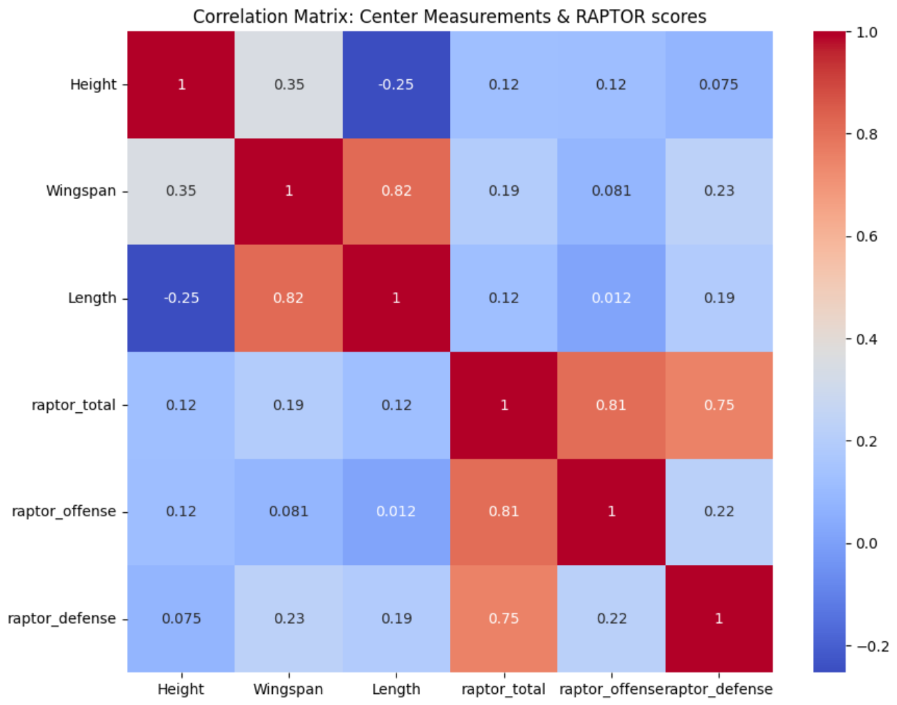
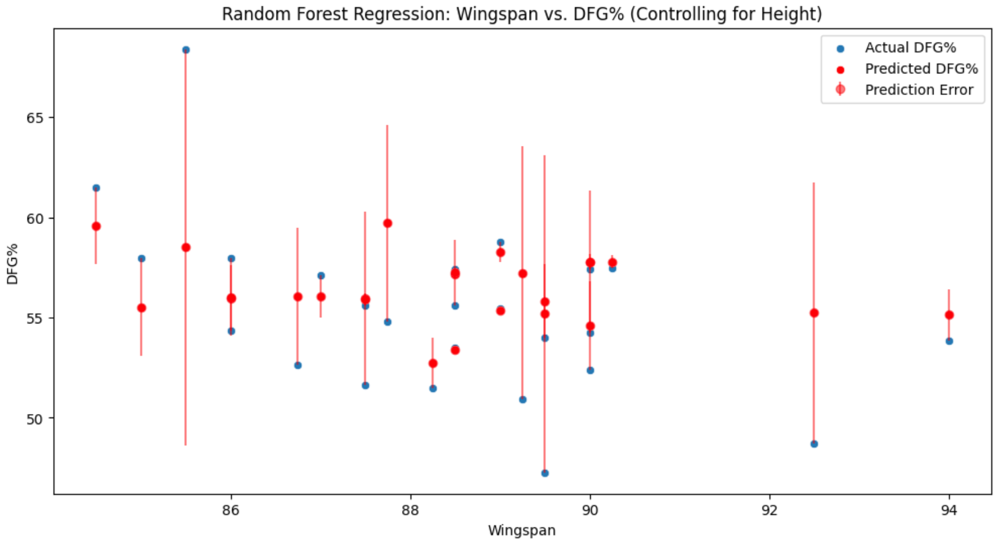

# NBA Wingspan vs. Performance

Does wingspan, a measurement that gets less attention than height, predict how well NBA players perform? This project combines three public datasets to find out. It analyzes guards, forwards, and centers separately.



## Key findings

- **Overall, wingspan is a weak predictor of performance.** The correlation between wingspan and total RAPTOR for centers is **0.19**.
- **Among centers, wingspan matters more than height,** especially for defensive RAPTOR. This fits the idea that length helps with rim protection.
- **Among guards, height is slightly more important than wingspan.** Offensive RAPTOR correlates more with size than defensive RAPTOR does.
- **Among forwards,** every player with a RAPTOR above 5 has an above-average wingspan for their position. Length (wingspan minus height) correlates with RAPTOR more strongly than wingspan alone.
- **A random forest model** predicted defensive field-goal percentage with a correlation of **0.56** between predicted and actual values (p ≈ 0.003). Some predictions have wide error bars.



## Data

| Source | What it provides |
|---|---|
| [CraftedNBA](https://craftednba.com/) | Height, wingspan, and length by position |
| [FiveThirtyEight modern RAPTOR](https://github.com/fivethirtyeight/data/tree/master/nba-raptor) | Offensive, defensive, and total player value |
| [NBA.com advanced stats](https://www.nba.com/stats) | Defensive field-goal percentage (DFG%) |

The raw CSV files are not included in this repo (`data/*.csv` is gitignored). Download them from the sources above and place them in `data/`.

## Method

1. **Cleaning.** Convert height and wingspan strings (for example `6'10"`) to inches.
2. **Noise reduction.** Average up to five seasons per player, and keep players with more than 400 minutes played.
3. **Merging.** Join the datasets on player name.
4. **Analysis.** For each position, check the height–wingspan correlation, plot wingspan against RAPTOR, and build correlation heatmaps.
5. **Modeling.** Regression and random forest models predict DFG% from body measurements. Results include error bars and significance tests.

## Limitations

- The method CraftedNBA used to collect wingspan measurements is unknown.
- Some groups are very small. For example, one guard has a 6'1" wingspan.
- **Survivorship bias:** undersized players who perform poorly get cut, so the remaining players are not a random sample.
- Joining on player name can silently drop players whose names are spelled differently across sources.
- Assumptions: players did not change positions over the five-season window.

## Repository structure

```
notebooks/Wingspans.ipynb   Full analysis (written for Google Colab)
src/data_processing.py      Height and wingspan parsing helpers
src/analysis.py             RAPTOR merge, scatter plots, correlations
figures/                    Saved plots
```

## Run it

```bash
git clone https://github.com/evan-nyhus18/nba-wingspan-data-analysis.git
cd nba-wingspan-data-analysis
pip install -r requirements.txt
jupyter notebook notebooks/Wingspans.ipynb
```

The notebook was written for Google Colab. Before running it locally, remove the `drive.mount(...)` cell and update the file paths to point at `data/`.

**Tech stack:** Python, pandas, NumPy, seaborn, matplotlib, SciPy, scikit-learn
